# ARCHIVO: informe_tecnico_industria_vidrio-v2.md

# INFORME TÉCNICO: INDUSTRIA DEL VIDRIO
**Cátedra:** Industrias y Servicios I  
**Institución:** Facultad de Ingeniería, Universidad Nacional de Cuyo (UNCuyo)  
**Tema:** Principales productos (vidrio plano, vidrio hueco/envases, fibras y vidrios especiales), sus procesos de fabricación, equipamiento, control de calidad y tendencias del sector vítreo  
**Fecha de emisión:** Octubre 2026  
**Versión:** 2.0 (Estructuración modular por Sección con Prompts de Sección y Diagramas)

---

### PROMPT DE SECCIÓN 1 – INTRODUCCIÓN
```
ÁMBITO: Definición físico-química del vidrio, estructura molecular vítrea amorfa, viscosidad y reología termomecánica, propiedades físicas y mecánicas cuantitativas (tracción, densidad, conductividad térmica y eléctrica), coloración por óxidos metálicos, y taxonomía general de productos primarios, secundarios y familias composicionales químicas.
LO QUE NO DEBE TRATAR: Cronología histórica de la producción (ver §2), dosificación minera de materias primas e insumos (ver §3), balance térmico de hornos e ingeniería de máquinas IS (ver §4), y variables macroeconómicas de mercado o comercio exterior (ver §5).
REGLAS: Usar SOLO datos de las fuentes. Citar valores numéricos con magnitud, unidad, año y fuente. Etiquetar vacíos de información con [NO ENCONTRADO EN FUENTES] y deducciones analíticas con [INTERPRETACIÓN]. Incluir texto explicativo y sintaxis para diagramas.
```

## 1. INTRODUCCIÓN

### 1.1 Naturaleza físico-química y reología del estado vítreo
El vidrio se define formalmente como una **sustancia inorgánica amorfa** producida a partir de la fusión a elevadas temperaturas de dióxido de silicio o sílice ($SiO_2$) en combinación con óxidos modificadores de red y estabilizantes, tales como boratos o fosfatos (Fuente: Cátedra Industrias y Servicios I, 2025, diapositiva 5). A diferencia de los sólidos cristalinos convencionales, carece de un punto de fusión termodinámico neto caracterizado por una entalpía de cambio de fase discreta; en su lugar, experimenta una transición vítrea progresiva en un intervalo térmico operativo situado entre los **500 °C y los 1.650 °C** (Fuente: Cátedra Industrias y Servicios I, 2025, diapositiva 7).

Su comportamiento reológico durante el enfriamiento responde a una curva logarítmica continua de viscosidad frente a la temperatura ($\log \eta$ vs. $T$):
* A **temperaturas elevadas** (cercanas al régimen de fusión de 1.500 °C), el fluido vítreo exhibe una **viscosidad baja**, comportándose mecánicamente como un *vidrio blando* con excelente fluidez para operaciones de corte de gotas y conformado mecánico (ver §4.1 y §4.2.2).
* Al **descender la temperatura**, la viscosidad se incrementa de manera exponencial, consolidando progresivamente un *vidrio duro* con elevada rigidez estructural y retención dimensional permanente.


### 1.2 Propiedades físicas, mecánicas y ópticas
De acuerdo con las mediciones técnicas y experimentales reportadas en la cátedra (Fuente: Cátedra Industrias y Servicios I, 2025, diapositiva 7):
* **Resistencia a la tracción:** el material presenta valores estándar típicos comprendidos entre **3.000 $N/cm^2$ y 5.500 $N/cm^2$** en condiciones convencionales de superficie. Sin embargo, bajo tratamientos térmicos avanzados de compresión superficial (vidrio templado) o ensayos libres de microfisuras de Griffith, alcanza resistencias de laboratorio de hasta **70.000 $N/cm^2$** (ver §4.2.1).
* **Densidad relativa:** oscila en un rango continuo entre **2 y 8**, fuertemente condicionada por la masa atómica de los cationes incorporados a la matriz de silicatos (alcanzando sus valores máximos en vidrios plúmbicos y baritados).
* **Conductividad termoeléctrica:** clasificado rigurosamente como un **mal conductor térmico y un mal conductor eléctrico**, cualidad que le confiere una elevada rigidez dieléctrica y aptitud aislante universal en arquitectura e ingeniería electrónica.
* **Aspecto óptico y coloración:** a nivel macroscópico, el vidrio puede elaborarse en acabados **transparentes, traslúcidos u opacos**. La modulación espectral selectiva del haz de luz se obtiene mediante la adición de componentes menores u óxidos cromóforos en la masa fundida (Fuente: Cátedra Industrias y Servicios I, 2025, diapositivas 5-6):
  * **Dióxido de Manganeso ($Mn$):** actúa como agente decolorante físico y químico al oxidar y compensar el color verde residual de las sales de hierro, produciendo un vidrio claro e incoloro.
  * **Cromita:** promueve la absorción lumínica en longitudes de onda específicas, generando la tonalidad verde característica de botellas de vino.
  * **Carbón vegetal:** agente reductor que induce tonalidades oscuras o ámbar/topacio de alta absorción actínica para vinos tintos y cervezas.
  * **Yeso (Sulfato de calcio):** agente modificador y afinante utilizado para la obtención de coloraciones más claras.
  * *Proporciones ponderales exactas de cada óxido colorante:* `[NO ENCONTRADO EN FUENTES]`.

### 1.3 Clasificación sistemática y familias de vidrios
La industria organiza los productos vítreos en función de su grado de procesamiento industrial y de su formulación química constitutiva (Fuente: Cátedra Industrias y Servicios I, 2025, diapositivas 8-10):

```mermaid
flowchart TD
    V["Industria del Vidrio"] --> P["1. Vidrios Primarios (Directos de Horno)"]
    V --> S["2. Productos Secundarios (Segunda Transformación)"]
    V --> F["3. Familias Químicas Especializadas"]

    subgraph Primarios [Vidrios Primarios]
        P --> P1["Por Proceso de Fabricación:<br>Flotado, Estirado, Pulido, Rolado, Baldosa, Grabado, Alambrado"]
        P --> P2["Por Visibilidad:<br>Transparente, Traslúcido"]
        P --> P3["Por Coloración:<br>Incoloro, Coloreado en Masa"]
    end

    subgraph Secundarios [Productos Secundarios]
        S --> S1["Seguridad Mecánica:<br>Templado, Laminado, Antibalas"]
        S --> S2["Acondicionamiento Ambiental:<br>Doble Vidriado Hermético (DVH), Acústico, Térmico"]
        S --> S3["Transformación Geométrica/Óptica:<br>Curvo recocido, Curvo templado, Espejos, Reflectante"]
    end

    subgraph Quimica [Familias Químicas]
        F --> F1["Sódico-Cálcico: SiO2-Na2O-CaO (Envases y plano masivo)"]
        F --> F2["Potásico-Cálcico: SiO2-K2O-CaO (Brillo y óptica)"]
        F --> F3["Borosilicato: SiO2-B2O3 (Resistencia al choque térmico)"]
        F --> F4["Plúmbico: SiO2-PbO (Alta densidad, blindaje Rayos X)"]
        F --> F5["Cuarzo / Sílice pura: 96% SiO2 (Alta refractariedad)"]
    end
```

#### 1.3.1 Vidrios Primarios
Son aquellos que emergen de la etapa de enfriamiento continuo a la salida del horno de fundición sin requerir tratamientos mecánicos o térmicos posteriores:
* **Por proceso de manufactura base:** vidrio flotado (*float* sobre lecho de estaño), estirado, pulido, rolado, baldosa de vidrio, grabado, alambrado (con retícula de alambre embutida), decorativo y reflejante.
* **Por visibilidad:** transparente (visión nítida directa) y traslúcido (difusor de luz sin nitidez visual).
* **Por masa:** vidrio incoloro y vidrio coloreado en su masa.

#### 1.3.2 Productos Secundarios
Comprenden manufacturas avanzadas que utilizan el vidrio primario como insumo de base, sometiéndolo a procesos térmicos, químicos o de ensamblaje estructural:
* Vidrio templado por cortinas de aire forzado y vidrio laminado con polivinil butiral (ver §4.2.1).
* Vidrio curvo recocido, curvo templado y curvo laminado.
* Vidrio insulado (doble vidriado hermético - DVH), espejos de plata, paneles acústicos y reflectivos de control solar.

#### 1.3.3 Familias químicas y funcionales especializadas
* **Vidrio Sódico-Cálcico ($SiO_2	ext{-}Na_2O	ext{-}CaO$):** la sílice estructura la red vitrificante, el sodio actúa como fundente químico y el calcio proporciona estabilidad frente al ataque del agua. Es la formulación hegemónica del 90% de la producción de botellas, frascos y ventanas (ver §3.1 y §4.2.2).
* **Vidrio Potásico-Cálcico ($SiO_2	ext{-}K_2O	ext{-}CaO$):** reemplaza el sodio por sales de potasio. Presenta una dureza superficial superior, mayor brillo refráctil y elevada resistencia al ataque químico y fluctuaciones térmicas, aplicándose en óptica fina y cristalería.
* **Vidrio Plúmbico ($SiO_2	ext{-}PbO	ext{-}K_2O$):** sustituye el óxido de calcio por óxido de plomo. Exhibe un índice de refracción y dispersión sumamente elevados, bajo punto de fusión, alta rigidez dieléctrica para condensadores y una notable capacidad de absorción de radiaciones ionizantes ultravioleta y rayos X (ver §4.2.3).
* **Vidrio de Borosilicato ($SiO_2	ext{-}B_2O_3$):** formulado con anhídrido bórico; exhibe un coeficiente de expansión térmica excepcionalmente bajo, confiriéndole inmunidad ante choques térmicos severos. Destinado a instrumental volumétrico de laboratorio y recipientes de cocción para hornos.
* **Vidrio de Cuarzo o Sílice Vítrea Pura:** integrado por un **96% de sílice fundida y un 3% de óxido de boro**. Es químicamente inerte, el más duro y resistente a temperaturas críticas; requiere procesos de fundición al vacío y se orienta a tecnología aeroespacial y lámparas de radiación especial.
* **Vidrios de Seguridad, Blindados y Especiales:** vidrios sometidos a pretensado térmico o interposiciones plásticas multicapa en autoclave, vidrios atérmicos de control solar con películas catódicas, dieléctricos de precisión y filamentos continuos de fibra de vidrio (ver §4.2.1 y §4.2.3).

---

### PROMPT DE SECCIÓN 2 – RESEÑA HISTÓRICA
```
ÁMBITO: Cronología histórica de la fabricación de vidrio, métodos de moldeo primitivos, invención del soplado por caña, centros de desarrollo hegemónico preindustriales (Venecia/Murano), escala en el siglo XVIII, transición energética del siglo XIX y automatización industrial del siglo XX.
LO QUE NO DEBE TRATAR: Formulación estequiométrica de materias primas (ver §1 y §3), parámetros de diseño de moldes y mecanismos IS modernos (ver §4.4), y análisis económico de empresas activas contemporáneas (ver §5.1).
REGLAS: Citar fuentes, fechas e hitos precisos de las fuentes. Etiquetar vacíos con [NO ENCONTRADO EN FUENTES]. Incluir línea de tiempo o diagrama cronológico con sintaxis Mermaid.
```

## 2. RESEÑA HISTÓRICA

### 2.1 Orígenes y método de moldeo primitivo (2500 a.C.)
El registro material más antiguo de la manufactura de vidrio se remonta al año **2500 a.C. en Egipto** (Fuente: Cátedra Industrias y Servicios I, 2025, diapositiva 3). Durante este período primitivo, el vidrio fundido pastoso no se conformaba en moldes cerrados; la metodología operativa consistía en el **moldeado de jarros, tazas y copas sobre un núcleo interno preformado compuesto de arena y arcilla**, sobre el cual se aplicaban sucesivas capas de masa vítrea caliente que eran alisadas exteriormente antes de retirar el núcleo pulverulento.

### 2.2 La invención de la caña hueca de soplado (Siglo I a.C.)
El hito más disruptivo en la ingeniería de conformado ocurrió en la región de **Palestina y Siria**, donde se descubrió el **método de soplado mediante caña metálica hueca** (Fuente: Cátedra Industrias y Servicios I, 2025, diapositiva 3). Este método permitía a los operarios extraer una porción de vidrio líquido incandescente e insuflar aire a través del conducto para expandir una cavidad hueca simétrica, logrando paredes de espesores notablemente más delgados y geometrías estandarizadas. Esta técnica artesanal dominó la manufactura sin variaciones conceptuales sustanciales hasta el siglo XIX.

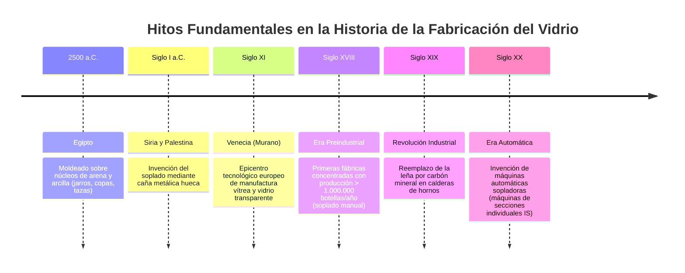

### 2.3 Hegemonía de Venecia y manufactura preindustrial (Siglos XI al XVIII)
A partir del **siglo XI**, la República de **Venecia** centralizó el desarrollo de la industria del vidrio en Europa, concentrando hornos e innovaciones en la isla de Murano para preservar los secretos gremiales de decoloración y cristalería artística (Fuente: Cátedra Industrias y Servicios I, 2025, diapositiva 3).

Hacia el **siglo XVIII**, se produjo la transición hacia la **primera industria vidriera formal**, estableciéndose instalaciones productivas capaces de alcanzar escalas de producción superiores a **1.000.000 de botellas por año** por complejo fabril (Fuente: Cátedra Industrias y Servicios I, 2025, diapositiva 4). No obstante, el volumen total y la homogeneidad dimensional continuaban severamente restringidos por el límite fisiológico y la destreza de los sopladores manuales.

### 2.4 La Revolución Industrial y la automatización moderna (Siglos XIX y XX)
Durante el **siglo XIX**, la Revolución Industrial impulsó una transformación radical en la termodinámica del proceso: **la leña fue reemplazada por el carbón mineral** como combustible primario para calentar las calderas y las cámaras de los hornos de fundición (Fuente: Cátedra Industrias y Servicios I, 2025, diapositiva 4). Esta transición posibilitó operar a temperaturas de fusión estables superiores a los 1.400 °C, mejorando el afino del vidrio y el rendimiento energético unitario.

A comienzos del **siglo XX**, se desarrollaron las **primeras máquinas automáticas sopladoras**, que sustituyeron definitivamente el esfuerzo pulmonar del artesano por aire comprimido industrial sincronizado mediante levas y actuadores mecánicos (Fuente: Cátedra Industrias y Servicios I, 2025, diapositiva 4). Esta innovación derivó en el diseño de las máquinas modernas de secciones independientes (*Individual Section Machines* - IS), que operan en flujo continuo a alta cadencia en las plantas actuales (ver §4.4).

---

### PROMPT DE SECCIÓN 3 – MATERIAS PRIMAS E INSUMOS
```
ÁMBITO: 3.1 Materias primas (arena silícea SiO2, sosa Solvay Na2CO3, caliza CaCO3, vidrio reciclado o calcín/cullet, y componentes menores cromóforos y afinantes). 3.2 Insumos auxiliares (gas natural, aire comprimido industrial, lubricante en frío, estaño metálico y embalajes). 3.3 Logística y transporte interno (recepción granel, tolvas basculantes hidráulicas, elevadores de cangilones, silos verticales de almacenamiento segregados por color). 3.4 Aspectos críticos de aprovisionamiento y vulnerabilidad de proceso (dependencia del gas natural, pureza mineral, riesgo de contaminantes metálicos en calcín).
LO QUE NO DEBE TRATAR: Reacciones termoquímicas y cinética de disolución en horno a 1.500 °C (ver §4.1) y balances macroeconómicos de importación de materias primas (ver §5.2).
REGLAS: Citar fuentes y magnitudes cuantitativas. Marcar vacíos con [NO ENCONTRADO EN FUENTES]. Incluir diagramas en sintaxis Mermaid sobre el circuito de materias primas y logística.
```

## 3. MATERIAS PRIMAS E INSUMOS

### 3.1 Materias primas
La formulación estequiométrica del vidrio sódico-cálcico industrial demanda la mezcla precisa de minerales naturales y vidrio reciclado clasificado (Fuente: Cátedra Industrias y Servicios I, 2025, diapositivas 11-13):

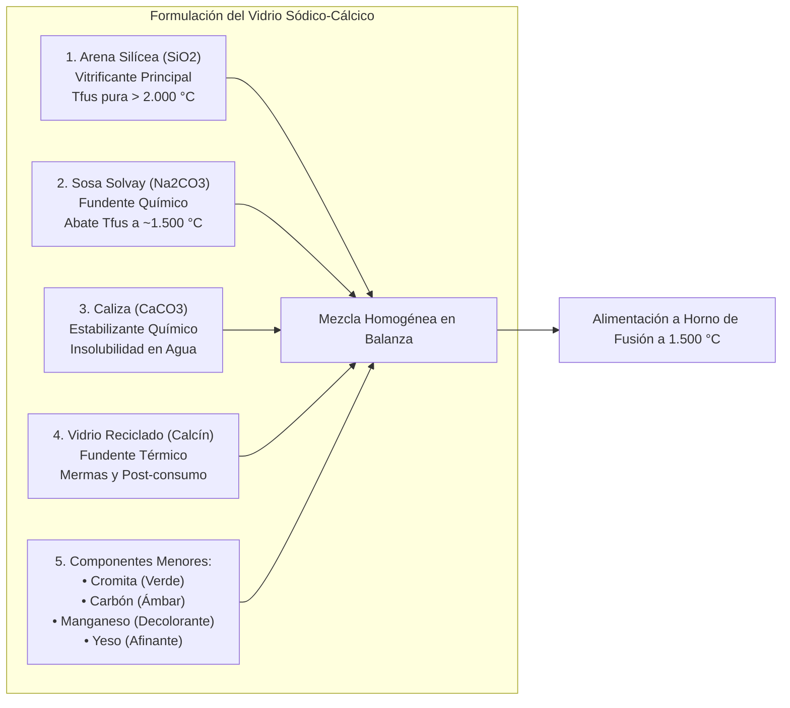

1. **Arena Silícea ($SiO_2$ - Agente Vitrificante Principal):**
   * Constituye la estructura de la red vítrea amorfa.
   * Su punto de fusión en estado puro supera los **2.000 °C**, temperatura económicamente inviable para operaciones continuas masivas. La adición de óxidos fundentes permite abatir la temperatura operativa de fusión a aproximadamente **1.500 °C**.
   * Se procesa en dos calidades principales: *arena común* (utilizada para vidrios verdes y coloreados con tolerancias de óxidos de hierro) y *arena blanca* (mineral de cuarzo de alta pureza química exento de hierro, indispensable para vidrio incoloro o blanco).
2. **Sosa / Ceniza de soda Solvay ($Na_2CO_3$ - Agente Fundente):**
   * El carbonato de sodio actúa rompiendo los puentes oxígeno-silicio de la red de sílice, rebajando drásticamente el punto de reblandecimiento y la viscosidad del baño a temperaturas inferiores a 1.600 °C.
3. **Caliza ($CaCO_3$ - Agente Estabilizante):**
   * El carbonato de calcio aporta óxido de calcio ($CaO$). Su función consiste en conferir estabilidad química frente al agua, la humedad atmosférica y los ácidos; sin calcio, la masa fundida silicatada de sodio formaría silicato de sodio soluble ("vidrio soluble"). Asimismo, modula la curva de viscosidad facilitando la retención de forma durante el moldeo en máquinas automáticas.
4. **Vidrio Reciclado (Calcín / Cullet):**
   * Fragmentos de vidrio triturados y desferrizados procedentes tanto de rechazos de fabricación internos de la planta (roturas en zona caliente o descarte de inspección) como de programas de recuperación urbana post-consumo.
   * Funciona como un acelerador térmico y fundente que reduce drásticamente el calor requerido para disolver la carga de arena virgen (ver §4.5).
5. **Componentes Menores (Cromóforos y Afinantes):**
   * Aditivos dosificados en pequeñas concentraciones para conferir atributos ópticos y fisicoquímicos: **cromita** para el verde botella, **carbón mineral/vegetal** para generar atmósferas reductoras y tonos ámbar oscuros, **dióxido de manganeso ($Mn$)** como agente decolorante compensador y **yeso ($CaSO_4 \cdot 2H_2O$)** como agente sulfurado para afino y clarificación de microburbujas.

### 3.2 Insumos auxiliares
El sostenimiento del flujo fabril continuo demanda insumos energéticos y mecánicos críticos (Fuente: Cátedra Industrias y Servicios I, 2025, diapositivas 14, 18, 22):
* **Gas Natural:** vector energético primario insustituible para alimentar los quemadores del horno de fundición continuo, operando en régimen 24 horas al día, los 365 días del año a 1.500 °C. *[NO ENCONTRADO EN FUENTES: consumo volumétrico unitario específico en $Nm^3/t$ de vidrio fundido].*
* **Aire Comprimido Industrial:** generado por centrales de compresores a presiones de servicio para alimentar los cilindros neumáticos de las máquinas conformadoras IS, así como las líneas de soplado del parisón y soplado final del envase.
* **Líquido Lubricante de Extremo Frío (*Cold End Coating*):** emulsión líquida aplicada por pulverización fina en la zona fría de la línea para recubrir exteriormente las botellas, otorgándoles lubricidad para prevenir abrasiones mecánicas y rayaduras por roce mutuo.
* **Estaño Metálico Puro:** consumido en estado fundido para constituir el baño líquido sellado sobre el cual flota el vidrio plano (ver §4.2.1), y en forma de aleaciones para el sellado hermético perimetral de unidades DVH.
* **Materiales de Empaque y Paletizado:** palets de madera normalizados, láminas divisorias de cartón o plástico corrugado y film de polietileno termocontraíble para el enfundado automatizado de las cargas unitarias.

### 3.3 Logística y transporte interno
La circulación de materiales dentro de la planta está mecanizada en circuitos continuos para prevenir contaminaciones y segregaciones (Fuente: Cátedra Industrias y Servicios I, 2025, diapositivas 14-15):

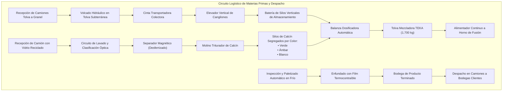

1. **Recepción a granel:** las arenas, calizas y carbonatos arriban en camiones tolva y se descargan en tolvas subterráneas mediante cilindros hidráulicos basculantes.
2. **Elevación y almacenamiento:** cintas transportadoras horizontales dirigen los minerales hacia un elevador vertical de cangilones que distribuye cada material en silos verticales sectorizados.
3. **Planta de tratamiento de calcín:** el vidrio reciclado post-consumo ingresa en camiones, pasa por circuitos de lavado y descarte manual, atraviesa separadores electromagnéticos de metales férricos (*desferrizado*), se tritura en molinos de impacto y se deposita en silos clasificados rigurosamente por color (verde, ámbar o blanco).
4. **Almacenamiento y expedición de envases terminados:** los pallets conformados se trasladan por transportadores de rodillos motorizados hacia el depósito cubierto de producto terminado, listos para su distribución a las bodegas.

### 3.4 Aspectos críticos de aprovisionamiento
La operación de la industria del vidrio presenta vulnerabilidades severas (Fuente: Cátedra Industrias y Servicios I, 2025, diapositiva 27):
* **Dependencia crítica del gas natural:** un horno de fundición no puede detenerse bajo ninguna circunstancia; si se interrumpe el suministro de gas natural, la masa vítrea solidifica irreversiblemente dentro de la cuba refractaria, inutilizando el horno e imponiendo pérdidas operativas y costos de reconstrucción millonarios.
* **Calidad y pureza granulométrica:** granulometrías excesivamente gruesas de arena no llegan a fundirse en el tiempo de residencia de 24 horas, generando defectos críticos de piedras o inclusiones no fundidas (ver §4.4).
* **Contaminación del calcín:** fragmentos de metales pesados en el vidrio reciclado (como plomo o aluminio) atacan y perforan por corrosión electroquímica las soleras refractarias del horno, mientras que cerámicas o porcelanas no funden a 1.500 °C, pasando como nódulos infundidos a las botellas.

---

### PROMPT DE SECCIÓN 4 – PROCESOS PRODUCTIVOS
```
ÁMBITO: 4.1 Fabricación del vidrio base (dosificación pesada, mezcladora TEKA de 1.700 kg, horno Saint-Gobain de 450 t a 1.500 °C, intercambiadores regenerativos de aire a 800 °C, sifón de afino y corte de gotas/gobs por tijera). 4.2 Conformado y productos: 4.2.1 Vidrio plano (flotado sobre estaño, templado, laminado, antibalas, DVH, reflectivo); 4.2.2 Vidrio hueco (procesos Presión-Soplado y Soplado-Soplado en máquinas IS en sus 6 etapas: Carga, Asentamiento, Soplo Parisón, Inversión, Soplo Final y Extracción; anatomía del envase); 4.2.3 Fibras y vidrios especiales (borosilicato, cuarzo 96%, dieléctricos de plomo, vitrocerámicas y fibra continua). 4.3 Infraestructura de planta. 4.4 Equipamiento y tecnología: mezcladora TEKA, horno Saint-Gobain, máquinas IS, horno de recocido (lehr) para evitar calcinadas; Sistema de Calidad Verallia (Laboratorios Químico por Rayos X, Producto Terminado y Microbiológico por filtración/UFC); Taxonomía de defectos Verallia (Críticos, Mayores/Principales, Menores/Secundarios y Aspecto). 4.5 Impacto ambiental (reciclabilidad 100%, reducción de CO2 y energía por calcín, ecodiseño botellas Ecova).
LO QUE NO DEBE TRATAR: Evolución histórica (ver §2) y cuotas de mercado de empresas productoras o balances de comercio exterior (ver §5).
REGLAS: Citar fuentes, parámetros numéricos de equipos y clasificaciones normativas. Indicar vacíos con [NO ENCONTRADO EN FUENTES]. Integrar diagramas de flujo de proceso continuo, secuencia cinemática IS y árbol de defectos en sintaxis Mermaid.
```

## 4. PROCESOS PRODUCTIVOS

### 4.1 Fabricación del vidrio base
La producción de vidrio fundido opera en régimen continuo las 24 horas del día (Fuente: Cátedra Industrias y Servicios I, 2025, diapositivas 15-17, 21):

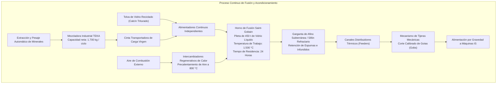

1. **Pesaje y dosificación automática:** balanzas electromecánicas extraen los pesos exactos de arena, caliza, sosa y aditivos según la receta de la colada.
2. **Mezclado industrial:** los componentes secos ingresan a una **máquina mezcladora TEKA con capacidad de 1.700 kg de carga por ciclo**, que homogeneiza la masa sólida pulverulenta.
3. **Fusión en horno continuo Saint-Gobain:**
   * La mezcla virgen homogeneizada y el calcín ingresan por bocas de carga independientes a una cámara refractaria que contiene una pileta continua con **450 toneladas de vidrio líquido en fusión**.
   * La masa vítrea permanece sometida a una temperatura de **1.500 °C durante un tiempo de residencia de 24 horas**, garantizando la descarbonatación, disolución de cuarzo y disipación de gases.
   * **Eficiencia térmica regenerativa:** el aire necesario para los quemadores de gas natural se precalienta en cámaras regenerativas refractarias hasta alcanzar **800 °C**, optimizando sustancialmente el balance energético.
4. **Afino y sifón refractario:** el vidrio purificado desciende y atraviesa un paso sumergido o sifón (*garganta*), impidiendo el arrastre superficial de espumas, escorias o partículas no fundidas.
5. **Acondicionamiento y corte de gotas (*feeders*):** el vidrio fluye por canales refractarios aislados donde se homogeniza térmicamente. En el cabezal de salida, unas tijeras mecánicas sincronizadas cortan la columna de fluido en porciones individuales denominadas **gotas de vidrio (*gobs*)**, estrictamente calibradas en peso, temperatura y viscosidad.

### 4.2 Conformado y productos

#### 4.2.1 Vidrio plano
El método hegemónico mundial es el **vidrio flotado (*float*)**, en el cual la lámina de vidrio fundido se vierte de forma continua sobre la superficie de una pileta de **estaño líquido** en atmósfera inerte controlada (Fuente: Cátedra Industrias y Servicios I, 2025, diapositivas 8, 10). La gravedad y las fuerzas de tensión superficial equilibran el fluido, obteniéndose una cinta continua de caras perfectamente planas y paralelas que no requiere desbaste ni pulido posterior. Métodos complementarios incluyen el estirado, pulido, rolado y grabado.

*Productos transformados secundarios de vidrio plano:*
* **Vidrio Templado:** láminas calentadas a temperaturas próximas al punto de ablandamiento y sometidas a un enfriamiento súbito con soplado de aire forzado. Se inducen tensiones residuales permanentes: las capas exteriores quedan en compresión y el núcleo interior en tracción. Ante una sobrecarga mecánica, la placa se fractura liberando la energía acumulada en miles de fragmentos pequeños y granulares no cortantes, alcanzando resistencias mecánicas de hasta **70.000 $N/cm^2$** (ver §1.2).
* **Vidrio Laminado:** estructura compuesta por dos o más hojas de vidrio unidas mediante una película intermedia plástica de polivinil butiral (PVB). Ante impactos que quiebran el vidrio, las esquirlas permanecen firmemente adheridas a la lámina elástica.
* **Vidrio Blindado (Antibalas):** paneles multilaminados compuestos por placas de vidrio de gran espesor y películas poliméricas sintetizadas en autoclave bajo alta presión y temperatura, diseñadas para amortiguar proyectiles balísticos.
* **Vidrio Insulado (Doble Vidriado Hermético - DVH):** dos hojas de vidrio separadas por una cámara estanca de aire seco o gas inerte, selladas con separadores metálicos soldados con estaño, concebidas para reducir drásticamente la transmitancia térmica y acústica en edificios.
* **Vidrio Reflectivo y de Control Solar:** láminas vítreas con recubrimientos pirolíticos o catódicos de óxidos metálicos que reflejan la radiación infrarroja y ultravioleta, regulando el calentamiento pasivo de construcciones.

#### 4.2.2 Vidrio hueco (envases y botellas)
El conformado de envases comprende dos tecnologías industriales (Fuente: Cátedra Industrias y Servicios I, 2025, diapositiva 17):
1. **Presión - Soplado (*Press and Blow*):** la gota cae en un premolde donde un punzón metálico la presiona mecánicamente para formar la preforma o *parisón* y la boca; luego, el parisón se transfiere al molde terminador donde se expande mediante soplado final de aire a presión.
2. **Soplado - Soplado (*Blow and Blow*):** proceso ejecutado en máquinas automáticas de secciones individuales (máquinas IS), donde tanto el parisón inicial como la botella terminada se conforman por impulsos neumáticos de aire a presión en seis etapas sincronizadas:

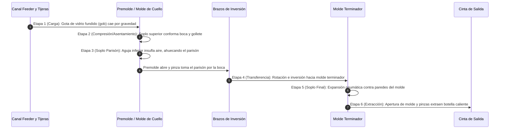

*Anatomía estandarizada del envase de vidrio:* la nomenclatura técnica de control divide el envase en siete zonas anatómicas específicas: **Boca** (corona, reborde y anillo de sellado), **Cuello**, **Hombro**, **Panel** (cuerpo cilíndrico de contacto y etiquetado), **Talón**, **Fondo** y **Anillo de Apoyo** (Fuente: Verallia Argentina, diapositiva 4).

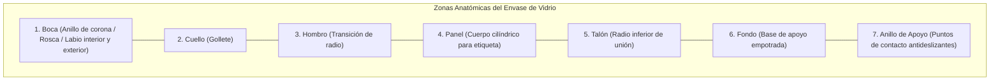

#### 4.2.3 Fibras y vidrios especiales
(Fuente: Cátedra Industrias y Servicios I, 2025, diapositivas 9-10):
* **Borosilicato:** formulación con óxido de boro con ultra-baja expansión térmica para balones químicos y vajilla refractaria.
* **Vidrio de Cuarzo Puro:** 96% de $SiO_2$, elasticidad restitutiva total y refractariedad extrema.
* **Vidrio Dieléctrico:** formulado con arcillas plúmbicas; posee alta constante dieléctrica y polarización dipolar, utilizándose en cintas aislantes para condensadores de alta frecuencia.
* **Vitrocerámicas:** vidrios nucleados térmicamente para generar fases microcristalinas uniformes, resistentes a choques térmicos súbitos en encimeras de cocina.
* **Fibra de Vidrio:** monofilamentos continuos estirados mecánicamente a alta velocidad a través de hileras de platino incandescente, destinados a telas ignífugas y polímeros reforzados (PRFV).

### 4.3 Infraestructura de planta
Una planta de envases de escala media integra las siguientes obras civiles y áreas operativas continuas (Fuente: Cátedra Industrias y Servicios I, 2025, diapositivas 14, 21):
* Batería vertical de silos de hormigón para acopio segregado de áridos y fundentes.
* Nave central de hornos con fundaciones refractarias aisladas, chimeneas de tiro y túneles de aire.
* Área caliente de conformado (*Hot End*), presurizada con ventiladores axiales de enfriamiento de moldes y compresores de aire.
* Línea longitudinal de hornos túnel de recocido (*lehrs*).
* Área fría de inspección optoelectrónica, laboratorio y empaque (*Cold End*).
* Depósitos cubiertos para almacenamiento de pallets enfundados a gran altura.

### 4.4 Equipamiento, tecnología y control de calidad

#### Parque de maquinaria industrial
(Fuente: Cátedra Industrias y Servicios I, 2025, diapositivas 18-20, 23):
* **Mezcladora TEKA:** equipo rotativo de turbomezclado intensivo con capacidad de 1.700 kg por ciclo.
* **Horno continuo Saint-Gobain:** cuba refractaria continua de 450 toneladas con quemadores de gas y precalentamiento regenerativo a 800 °C.
* **Máquinas IS:** máquinas automáticas de secciones múltiples independientes con sincronización neumático-electrónica.
* **Horno de Recocido (*Lehr*):** túnel continuo con gradiente térmico descendente controlado. Cumple la función crítica de **relevar las tensiones térmicas residuales** inducidas por el enfriamiento asimétrico en la máquina IS, previniendo fallas frágiles de **calcinada** (fractura por choque térmico). Previo a su ingreso, los envases atraviesan un túnel de atemperado preliminar por aire.
* **Líneas de empaque:** transportadores en frío con lubricación superficial y paletizadoras automáticas continuas italianas y portuguesas.

#### Sistema de Gestión de Calidad (Laboratorios Verallia Argentina)
El control de calidad se estructura en tres laboratorios analíticos independientes (Fuente: Verallia Argentina, diapositivas 16-17):
1. **Laboratorio Químico:** equipado con un **espectrómetro de fluorescencia de Rayos X**, analiza la composición estequiométrica de las materias primas minerales y verifica la concentración de óxidos en el vidrio terminado.
2. **Laboratorio de Producto Terminado:** ejecuta ensayos de metrología dimensional, capacidad volumétrica, resistencia al choque térmico por inmersión en agua y resistencia a la presión hidrostática interna antes del despacho.
3. **Laboratorio Microbiológico:** realiza ensayos analíticos de filtración por membrana para detectar partículas de vidrio submicroscópicas y recuentos de **Unidades Formadoras de Colonias (UFC)** para garantizar la inocuidad biológica de botellas estibadas.

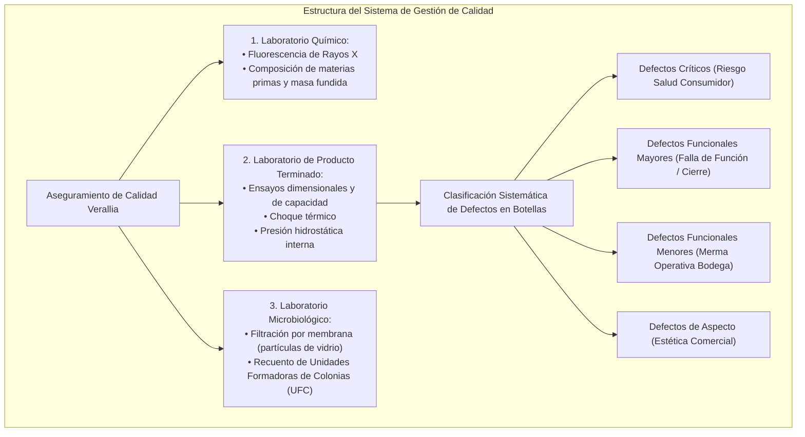

#### Clasificación Sistemática de Defectos en Envases (Norma Verallia)
Los defectos se categorizan en cuatro niveles según su severidad operativa (Fuente: Verallia Argentina, diapositivas 5-15):

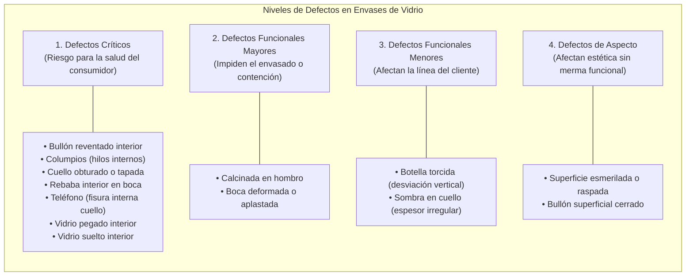

1. **Defectos Críticos:** anomalías que ponen en riesgo directo la salud, seguridad física o vida del consumidor final. Características: están asociados a la introducción o desprendimiento de fragmentos vítreos en el líquido envasado; no siempre son visibles a simple vista y no suelen provocar la rotura inmediata del envase.
   * *Bullón interior reventado:* ampolla de gas en la pared interna cuya fina película colapsa liberando esquirlas.
   * *Columpios:* filamento de vidrio en forma de puente que cruza transversalmente el lumen interno de la botella.
   * *Cuello obturado o tapada:* membrana o protuberancia de vidrio sólido que obstruye la luz del gollete.
   * *Rebaba interior en la boca:* arista filosa y cortante proyectada hacia el interior de la embocadura.
   * *Teléfono:* fisura laminar interna en el cuello con morfología curva similar al auricular de un teléfono.
   * *Vidrio interior pegado:* gota o escama fundida adherida a la pared interna, susceptible de soltarse.
   * *Vidrio interior suelto:* fragmento vítreo libre desprendido en el fondo del recipiente vacío.
2. **Defectos Funcionales Mayores (Principales):** fallas físicas o mecánicas graves que impiden que el envase cumpla la función básica para la que fue diseñado (hermeticidad, tapado o retención de presión).
   * *Calcinada en el hombro:* grieta térmica profunda que inutiliza mecánicamente la botella.
   * *Boca deformada:* ovalización o distorsión del anillo de embocadura que impide el sellado estanco del corcho o tapa corona.
3. **Defectos Funcionales Menores (Secundarios):** anomalías que provocan paradas de línea, descalibraciones o mermas de velocidad en las máquinas de fraccionamiento del cliente bodeguero.
   * *Botella torcida:* desalineación angular del eje vertical del cuerpo con respecto a la perpendicular del fondo.
   * *Sombra en cuello:* espesor asimétrico de pared en la zona del cuello que afecta la guía de llenado.
4. **Defectos de Aspecto / Apariencia:** irregularidades visuales superficiales que no alteran la resistencia mecánica ni funcional del envase, pero desmerecen la calidad comercial percibida.
   * *Superficie esmerilada:* opacidad superficial, manchas de molde o roce prematuro.
   * *Bullón superficial cerrado:* burbuja de gas de dimensiones reducidas completamente ocluida en la pared exterior.

### 4.5 Impacto ambiental y ecodiseño
La fabricación de vidrio incorpora directrices de sostenibilidad industrial (Fuente: Cátedra Industrias y Servicios I, 2025, diapositivas 11, 22, 27):
* **Reciclabilidad infinita:** el material se funde y reconforma indefinidamente en ciclos cerrados sin mermas cualitativas.
* **Abatimiento energético mediante calcín:** la inclusión de vidrio reciclado como fundente térmico disminuye linealmente el consumo de gas natural en los hornos y abate las emisiones directas de $CO_2$ generadas por la descomposición química de carbonatos virgen (caliza y soda).
* **Ecodiseño y aligeramiento (Línea Ecova de Verallia):** reducción planificada del peso unitario en gramos de las botellas sin comprometer su resistencia a la presión ni al impacto, disminuyendo el consumo de energía en fundición y la huella de carbono asociada al transporte logístico de vino en camiones.
* **Monitoreo de efluentes:** control y mitigación de emisiones gaseosas en chimenea ($NO_x$ y $CO_2$) mediante optimización de la combustión regenerativa a 800 °C.

---

### PROMPT DE SECCIÓN 5 – ANÁLISIS DE CONTEXTO
```
ÁMBITO: 5.1 Contexto nacional y regional: 5.1.1 Localización geográfica e implantación (polo Mendoza/Guaymallén); 5.1.2 Producción y ventas (datos CAFAVI: 15 empresas, 5.500 operarios, Argentina 3° mercado de envases de América Latina; mercado Mendoza: Verallia 65%, Cattorini 20%, Importados 15%; datos operativos de Verallia: fundación 1947, Grupo Saint-Gobain 1998, marca Verallia 2010, 295 empleados, 2 hornos, 150.000 t/año, 1.000.000 botellas/día, líneas comerciales); 5.1.3 Marco normativo (certificación de normas internacionales, INDEC CSA 2.0 y NCM Cap. 70); 5.1.4 Empresas y cadena de valor (mineras, gas, vidrieras, bodegas). 5.2 Contexto internacional: 5.2.1 Producción global [NO ENCONTRADO EN FUENTES]; 5.2.2 Comercio exterior (balanza comercial de vidrio en Argentina deficitaria según CAFAVI; exportaciones: botellas, frascos, fibra de vidrio hacia Uruguay, Chile y Brasil; importaciones: espejos automotrices, envases V < 0,33 L, envases V > 0,33 L desde Brasil, China y Chile; contexto macro OEC); 5.2.3 Acuerdos comerciales (Mercosur). 5.3 Actualidad del sector (vulnerabilidad de gas, costos, concentración). 5.4 Perspectivas y tendencias: 5.4.1 Tendencias de producto (aligeramiento Ecova, DVH y reflectivos); 5.4.2 Tendencias de proceso (tasa de calcín, regeneración térmica, Rayos X); 5.4.3 Tendencias de mercado y sustitución (inercia a favor del vidrio en vinos, amenaza de importados).
LO QUE NO DEBE TRATAR: Detalle de reacciones químicas de fusión (ver §4.1) ni protocolos de laboratorio de defectos (ver §4.4).
REGLAS: Citar fuentes, cifras exactas y años. Indicar vacíos con [NO ENCONTRADO EN FUENTES]. Integrar diagramas de cadena de valor y matriz de comercio exterior en sintaxis Mermaid.
```

## 5. ANÁLISIS DE CONTEXTO

### 5.1 Contexto nacional y regional (Argentina y Mendoza)

#### 5.1.1 Localización geográfica e implantación
En la República Argentina, la industria de fabricación de vidrio hueco para envases presenta una marcada concentración espacial en cercanía a los polos agroindustriales y de consumo de bebidas. En la provincia de Mendoza, la actividad productiva está orientada casi con exclusividad a la provisión de botellas para la industria vitivinícola y aceitera (Fuente: Cátedra Industrias y Servicios I, 2025, diapositivas 23-25). El complejo fabril de Verallia Argentina (Saint-Gobain Rayen Cura) se localiza en el departamento de Guaymallén, provincia de Mendoza, garantizando un enlace directo de abastecimiento hacia las principales bodegas de la región de Cuyo.

#### 5.1.2 Producción y ventas
El marco sectorial relevado por la Cámara Argentina de Fabricantes de Vidrio (CAFAVI) arroja los siguientes indicadores para el territorio nacional (Fuente: Cátedra Industrias y Servicios I, 2025, diapositiva 24):
* **Estructura empresarial:** **15 empresas fabricantes activas** radicadas en el país.
* **Empleo directo:** **5.500 trabajadores registrados** ocupados en la actividad.
* **Escala continental:** Argentina se posiciona formalmente como el **tercer mercado de envases de vidrio más grande de América Latina**.

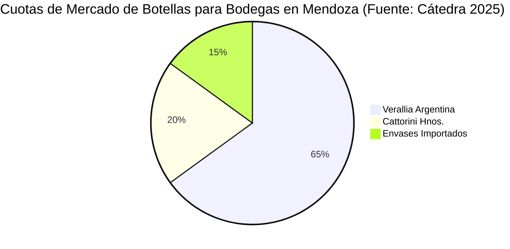

En la provincia de Mendoza, el abastecimiento de botellas de vidrio exhibe una estructura altamente concentrada (Fuente: Cátedra Industrias y Servicios I, 2025, diapositiva 25):
* **Verallia Argentina:** concentra el **65% del volumen del mercado**.
* **Cattorini Hnos.:** abastece el **20% de la demanda**.
* **Envases Importados:** completan el restante **15% del mercado local**.

*Ficha técnica operativa de Verallia Argentina (Saint-Gobain Rayen Cura Mendoza):*
* **Fundación inicial:** año **1947** (como Rayen Cura).
* **Trayectoria corporativa:** adquisición por el Grupo Saint-Gobain en **1998**; presentación oficial de la marca global **Verallia** en **2010**.
* **Fuerza laboral:** **295 empleados directos**.
* **Parque térmico:** **2 hornos continuos de fundición**.
* **Capacidad instalada:** **150.000 toneladas anuales de vidrio**.
* **Cadencia de producción:** aproximadamente **1.000.000 de botellas por día**.
* **Líneas comerciales:** Burdeos, Borgoña, Espumantes, Aceite y línea ecológica aligerada *Ecova*.

#### 5.1.3 Marco normativo e institucional
Las empresas vidrieras operan bajo estándares de gestión ambiental, inocuidad alimentaria y calidad bajo "Certificación de normas internacionales" (Fuente: Cátedra Industrias y Servicios I, 2025, diapositiva 27). *[NO ENCONTRADO EN FUENTES: números específicos de normas ISO/IRAM aplicadas].* A nivel estadístico oficial, el sector es relevado por el INDEC dentro de la Clasificación de Actividades (CSA 2.0) y la Nomenclatura Común del Mercosur (NCM), dentro de la Sección XIII y el Capítulo 70 ("Vidrio y sus manufacturas") (Fuente: INDEC, 2025, Cuadros 2.4.6, 2.4.7, 2.4.8).

#### 5.1.4 Empresas y cadena de valor
La cadena de valor vidriera en la región de Cuyo se articula verticalmente en cuatro eslabones secuenciales (Fuente: Cátedra Industrias y Servicios I, 2025, diapositiva 26):

```mermaid
flowchart LR
    subgraph Eslabon_Aguas_Arriba [1. Aguas Arriba: Insumos y Energía]
        M1["Canteras Mineras (Arenas Cuarcíferas y Caliza)"]
        M2["Industria Química (Ceniza de Soda Solvay)"]
        M3["Red de Gas Natural de Alta Presión"]
    end

    subgraph Eslabon_Industrial [2. Manufactura Vítrea: Mendoza]
        V1["Verallia Argentina (65% del Mercado)<br>150.000 t/año - 1.000.000 botellas/día"]
        V2["Cattorini Hnos. (20% del Mercado)"]
        V3["Envases Importados (15% del Mercado)"]
    end

    subgraph Eslabon_Aguas_Abajo [3. Clientes y Demanda Final]
        B1["Bodegas Vitivinícolas (Vinos y Espumantes)"]
        B2["Plantas Fraccionadoras de Aceite de Oliva"]
        C1["Consumidor Final Nacional e Internacional"]
    end

    Eslabon_Aguas_Arriba --> Eslabon_Industrial
    Eslabon_Industrial --> Eslabon_Aguas_Abajo
```

### 5.2 Contexto internacional

#### 5.2.1 Producción global
El vidrio es un commoditie industrial esencial. *[NO ENCONTRADO EN FUENTES: tonelaje global anualizado de producción agregada].*

#### 5.2.2 Comercio exterior del sector vidriero argentino
De acuerdo con las estadísticas sectoriales de CAFAVI, **la balanza comercial de la industria del vidrio en Argentina ha sido sistemáticamente deficitaria** durante los ejercicios previos a la pandemia (Fuente: Cátedra Industrias y Servicios I, 2025, diapositiva 24).

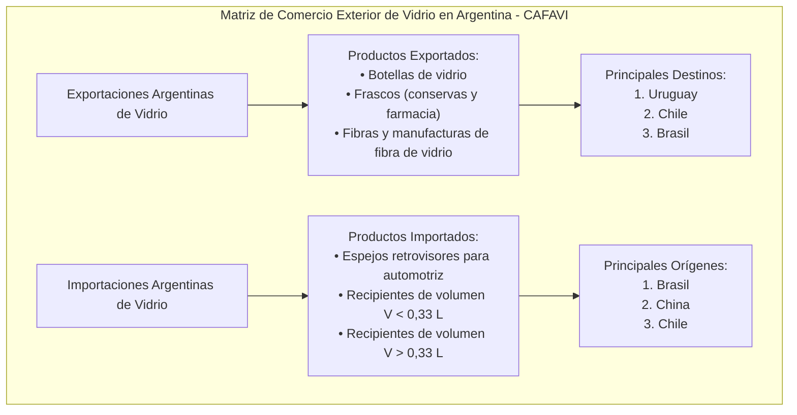

La matriz cualitativa de intercambio exterior presenta la siguiente estructura (Fuente: Cátedra Industrias y Servicios I, 2025, diapositiva 24):
* **Exportaciones sectoriales:**
  * *Productos transados:* botellas de vidrio, frascos para conservas y productos de fibra de vidrio.
  * *Destinos prioritarios:* Uruguay, Chile y Brasil.
* **Importaciones sectoriales:**
  * *Productos ingresados:* espejos retrovisores para vehículos, envases de volumen inferior a 0,33 litros ($V < 0,33\ l$) y envases de volumen superior a 0,33 litros ($V > 0,33\ l$).
  * *Orígenes principales:* Brasil, China y Chile.

*Contexto macroeconómico general del comercio de Argentina:*
Según el Observatory of Economic Complexity (OEC), las exportaciones totales de bienes de Argentina en 2024 totalizaron **75.000 millones de USD** (ubicando al país en el puesto 48 global), mientras que las importaciones sumaron **59.600 millones de USD** (puesto 54). Hacia agosto de 2026, la balanza comercial mensual del país consolidó un superávit de **2.190 millones de USD** (exportaciones por **8.880 millones de USD** frente a importaciones por **6.700 millones de USD**), manteniendo como principales socios a Brasil, China y Estados Unidos (Fuente: OEC, 2026).

#### 5.2.3 Acuerdos comerciales y bloques regionales
El intercambio comercial de vidrio se encuentra pautado bajo el marco arancelario del Mercosur (con Brasil como socio central) y acuerdos bilaterales con Chile y Uruguay, viabilizados por aranceles preferenciales intrazona y transporte carretero directo (Fuente: Cátedra Industrias y Servicios I, 2025, diapositiva 24; INDEC, 2025).

### 5.3 Actualidad del sector
El entramado productivo nacional enfrenta restricciones operativas derivadas de la alta concentración de oferta, fluctuaciones en los costos energéticos y una balanza comercial sectorial deficitaria (Fuente: Cátedra Industrias y Servicios I, 2025, diapositivas 24, 27).

### 5.4 Perspectivas y tendencias

#### 5.4.1 Tendencias de producto
* **Aligeramiento de masa (*Lightweighting*):** consolidación de envases con menor gramaje de vidrio (línea *Ecova*) que conservan la resistencia mecánica mediante optimización de la distribución de espesores de pared en máquinas IS (Fuente: Cátedra Industrias y Servicios I, 2025, diapositivas 23, 27).
* **Vidrio plano bioclimático:** mayor penetración de unidades DVH y vidrios reflectivos en construcción civil (ver §4.2.1).

#### 5.4.2 Tendencias de proceso y energía
* **Tasas crecientes de calcín en carga:** incremento del porcentaje de cullet reciclado para reducir la huella de carbono y el consumo de gas natural (ver §3.1).
* **Optimización regenerativa:** recuperación de calor de gases de chimenea para precalentar aire de combustión a 800 °C (ver §4.1).
* **Inspección automática optoelectrónica:** control en línea con cámaras multieje y fluorescencia de Rayos X (ver §4.4).

#### 5.4.3 Tendencias de mercado y sustitución
* **Fidelidad al vidrio en bebidas nobles:** el consumidor y la enología asocian el vidrio con inercia organoléptica y protección de aromas, haciendo que la amenaza de envases sustitutos (latas o bag-in-box) sea marginal en vinos finos y espumantes (Fuente: Cátedra Industrias y Servicios I, 2025, diapositiva 26).
* **Presión competitiva de importados:** persistencia del riesgo de sustitución por envases importados de la región si se suscitan desequilibrios cambiarios o desabastecimiento interno (Fuente: Cátedra Industrias y Servicios I, 2025, diapositiva 27).

---

### PROMPT DE SECCIÓN 6 – CONCLUSIONES
```
ÁMBITO: Síntesis evaluativa global de los hallazgos técnicos, energéticos, operacionales, normativos y estratégicos del informe.
LO QUE NO DEBE TRATAR: Nuevos datos numéricos o descripciones de procesos no presentados previamente (ver §1 a §5).
REGLAS: Derivar exclusivamente de las secciones previas. Sintetizar los pilares en un diagrama conceptual Mermaid.
```

## 6. CONCLUSIONES

1. **Inercia y nobleza del material de ingeniería:** el vidrio destaca por su absoluta inercia química frente al contacto con alimentos y bebidas, una reciclabilidad infinita al 100% en ciclo cerrado y una versatilidad funcional que abarca desde botellas masivas hasta vidrios reflectivos y dieléctricos de alta tecnología (ver §1 y §4.2).
2. **Alta intensidad de capital y criticidad energética:** el proceso industrial es continuo 24/7 y no interrumpible, donde la estabilidad del suministro de gas natural y la integridad térmica de la pileta de fundición de 450 toneladas a 1.500 °C condicionan la supervivencia técnico-económica de la planta (ver §3.4 y §4.1).
3. **Inocuidad alimentaria y prioridad en defectos críticos:** la gestión de calidad en envases subordina los parámetros estéticos a la estricta detección de *defectos críticos* (columpios, bullones interiores reventados y partículas desprendidas), garantizando la integridad biológica y física del consumidor (ver §4.4).
4. **Estructura de mercado duopólica en Mendoza:** la producción de vidrio hueco en la provincia de Mendoza exhibe una alta concentración liderada por Verallia Argentina (65%) y Cattorini Hnos. (20%), estrechamente integrada a la cadena vitivinícola regional, enfrentando a nivel nacional una balanza comercial sectorial históricamente deficitaria (ver §5.1 y §5.2).
5. **Ejes de sostenibilidad industrial:** la competitividad futura de la manufactura vidriera estará regida por la maximización del uso de calcín post-consumo, el ecodiseño mediante botellas aligeradas de la línea Ecova y el precalentamiento regenerativo a 800 °C para mitigar las emisiones de gases de efecto invernadero (ver §4.5 y §5.4).

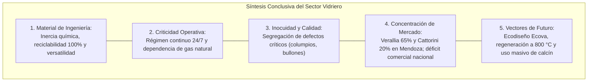

---

### PROMPT DE SECCIÓN 7 – GLOSARIO
```
ÁMBITO: Definición técnica rigurosa de términos especializados, siglas, defectos y vocabulario ingenieril empleado a lo largo del documento.
LO QUE NO DEBE TRATAR: Discusión teórica extendida de temas de capítulos específicos (ver §1 a §5).
REGLAS: Citar fuentes cuando corresponda y mantener definiciones concisas y técnicamente exactas.
```

## 7. GLOSARIO

* **Bullón:** burbuja u oclusión gaseosa en la masa vítrea; se clasifica como crítico si se ubica reventado en el interior de la botella, o de aspecto si está cerrado en la superficie exterior (Fuente: Verallia Argentina).
* **Calcín / Cullet:** vidrio triturado proveniente de mermas de planta o recolección urbana, lavado y separado por color, empleado como fundente en el horno (Fuente: Cátedra 2025).
* **Calcinada:** fractura térmica o fisura frágil producida en el envase por choques térmicos o deficiente recocido (Fuente: Verallia Argentina).
* **Columpio:** hilo o filamento de vidrio fundido que cruza de pared a pared en el interior de una botella, constituyendo un defecto crítico por peligro de desprendimiento (Fuente: Verallia Argentina).
* **Dieléctrico:** material mal conductor eléctrico que se polariza internamente ante un campo eléctrico; aplicado a vidrios con arcillas plúmbicas para capacitores (Fuente: Cátedra 2025).
* **Doble Vidriado Hermético (DVH):** componente arquitectónico de dos láminas de vidrio con cámara de aire deshumidificado soldada perimetralmente (Fuente: Cátedra 2025).
* **Ecova:** línea de botellas comerciales de diseño ecológico caracterizada por un menor gramaje de vidrio y menor huella de carbono (Fuente: Verallia Argentina).
* **Gob (Gota de vidrio):** porción de vidrio viscoso a temperatura calibrada cortada por tijeras mecánicas para alimentar un premolde (Fuente: Cátedra 2025).
* **Lehr (Horno de recocido):** horno túnel continuo con gradiente decreciente de temperatura para disipar esfuerzos mecánicos residuales (Fuente: Cátedra 2025).
* **Máquina IS (*Individual Section*):** máquina conformadora automática de botellas formada por secciones independientes que operan en paralelo coordinado (Fuente: Cátedra 2025).
* **Parisón:** esbozo o preforma hueca primaria del envase conformada en el premolde antes del soplado final (Fuente: Cátedra 2025).
* **Rebaba:** lámina o filo cortante de vidrio en la embocadura de la botella generada por desajustes en el molde (Fuente: Verallia Argentina).
* **Sosa Solvay:** carbonato de sodio ($Na_2CO_3$), insumo químico fundente fundamental en la manufactura de vidrios silicatados (Fuente: Cátedra 2025).
* **Teléfono:** fisura transversal interna con forma semicircular en la zona del cuello de la botella (Fuente: Verallia Argentina).
* **Vidrio Flotado (*Float*):** proceso continuo de formación de vidrio plano vertido sobre una pileta de estaño líquido en atmósfera inerte (Fuente: Cátedra 2025).

---

### PROMPT DE SECCIÓN 8 – BIBLIOGRAFÍA
```
ÁMBITO: Relación exhaustiva y formal de las fuentes documentales utilizadas en la elaboración del informe.
LO QUE NO DEBE TRATAR: Textos fuera de las fuentes provistas en el repositorio de la cátedra.
REGLAS: Citar bajo formato unificado indicando autor/organismo, año, título, tipo de documento y entidad editora.
```

## 8. BIBLIOGRAFÍA Y FUENTES

1. **Cátedra de Industrias y Servicios I (2025).** *Industria del Vidrio: presentación 2025*. Material docente audiovisual y técnico, Facultad de Ingeniería, Universidad Nacional de Cuyo (UNCuyo), Mendoza, Argentina.
2. **Verallia Argentina - Saint-Gobain Rayen Cura (2010/2020).** *Defectos del vidrio: Control de Calidad*. Departamento de Aseguramiento de la Calidad, Guaymallén, Mendoza, Argentina.
3. **Instituto Nacional de Estadística y Censos - INDEC (2025).** *Anuario Estadístico de la República Argentina 2024/2025*. Cuadros de Comercio Internacional (2.4.4, 2.4.6, 2.4.7, 2.4.8, 2.4.11) e Índice del Costo de la Construcción (2.5.3.2, 2.5.3.4), Buenos Aires, Argentina.
4. **Observatory of Economic Complexity - OEC (2024/2026).** *Argentina (ARG) Exports, Imports, and Trade Partners*. Base BACI / HS22, Datawheel, Cambridge, MA.

---

### PROMPT DE SECCIÓN 9 – ANEXOS
```
ÁMBITO: Anexo I: Vacíos de información identificados en las fuentes con la etiqueta [NO ENCONTRADO EN FUENTES]; Anexo II: Matriz FODA Integral del Sector Vidriero en Mendoza (Verallia Argentina); Anexo III: Catálogo Taxonómico Detallado de Defectos en Envases según Norma Verallia (con ubicación anatómica, mecanismo de falla y nivel de riesgo).
LO QUE NO DEBE TRATAR: Repetición narrativa de secciones previas.
REGLAS: Estructurar en tablas comparativas rigurosas con citas y parámetros de control.
```

## ANEXOS

### Anexo I: Vacíos de información identificados en las fuentes
En estricto cumplimiento de las **Reglas de Veracidad** fijadas en la consigna de cátedra, se detallan a continuación las variables técnicas, ambientales y sectoriales que no pudieron cuantificarse numéricamente por no encontrarse presentes en las fuentes documentales:

| N° | Variable Técnica / Económica | Detalle del Dato No Localizado | Estado de Verificación |
| :---: | :--- | :--- | :---: |
| **1** | Consumo específico de gas natural en hornos | No se registra el valor de consumo unitario de gas en $Nm^3/t$ de vidrio fundido ni en $GJ/t$ (sólo se indica la necesidad crítica de gas y los 1.500 °C). | `[NO ENCONTRADO EN FUENTES]` |
| **2** | Emisiones volumétricas en chimenea | No constan los factores numéricos de emisión de $CO_2$ ($kg\ CO_2/t$), óxidos de nitrógeno ($NO_x$) ni material particulado en chimeneas. | `[NO ENCONTRADO EN FUENTES]` |
| **3** | Producción mundial anual consolidada | Las fuentes no contienen el tonelaje agregado global de vidrio producido en el mundo. | `[NO ENCONTRADO EN FUENTES]` |
| **4** | Códigos numéricos de normas certificadas | Se indica la "Certificación de normas internacionales", pero se omiten los códigos específicos (e.g. ISO 9001, 14001, 22000, FSSC 22000 o IRAM). | `[NO ENCONTRADO EN FUENTES]` |
| **5** | Montos monetarios desagregados de balanza de vidrio | Se detalla que la balanza comercial de vidrio en Argentina es deficitaria y se listan productos y países, pero se omiten las cifras monetarias exactas en USD para cada subpartida arancelaria. | `[NO ENCONTRADO EN FUENTES]` |

---

### Anexo II: Matriz FODA Integral del Sector Vidriero en Mendoza (Verallia Argentina)
*Fuente: Cátedra Industrias y Servicios I, 2025, diapositivas 26-27.*

| Dimensión | Variables Identificadas en Fuentes |
| :--- | :--- |
| **Fortalezas (Internas)** | • Elaboración de un producto ecológico y 100% reciclable en circuito cerrado.<br>• Producto especializado de alta gama adaptado a la industria vitivinícola regional.<br>• Tecnología de última generación (ingeniería Saint-Gobain, hornos de 450 t, mezcladora TEKA).<br>• Calidad certificada y respaldada por 3 laboratorios (Químico por Rayos X, Microbiológico y Producto Terminado).<br>• Amplia trayectoria fabril en la provincia (fundación en 1947).<br>• Respaldo corporativo de un grupo líder mundial y marca global reconocida (Verallia / Saint-Gobain).<br>• Certificación de normas internacionales. |
| **Debilidades (Internas)** | • Materia prima crítica: dependencia de calidad constante de arenas cuarcíferas y carbonato de sodio.<br>• Necesidad crítica, ininterrumpida y permanente de gas natural (proceso no apagable).<br>• Elevado poder de negociación y dependencia directa de los requerimientos de las bodegas clientes. |
| **Oportunidades (Externas)** | • Ubicación geográfica estratégica en el departamento de Guaymallén, corazón del polo vitivinícola.<br>• Demanda sostenida y creciente de botellas impulsada por la industria del vino y espumantes.<br>• Mayor conciencia comunitaria sobre sustentabilidad y cuidado ambiental.<br>• Inexistencia o baja penetración de productos sustitutos (latas, tetrabrik) en vinos finos.<br>• Disponibilidad de mano de obra técnica calificada en la región de Cuyo. |
| **Amenazas (Externas)** | • Regímenes de promoción industrial en otras regiones o países competidores.<br>• Escenario de incertidumbre macroeconómica y política a nivel nacional.<br>• Pérdida de competitividad y bajo nivel de inversiones globales en el país.<br>• Presión competitiva e ingreso latente o real de envases importados de la región (15% del mercado local). |

---

### Anexo III: Catálogo Taxonómico Detallado de Defectos en Envases (Norma Verallia)
*Fuente: Verallia Argentina - Saint-Gobain Rayen Cura, diapositivas 5-15.*

| Categoría de Severidad | Nombre Técnico del Defecto | Zona Anatómica del Envase | Mecanismo de Falla / Descripción Física | Nivel de Riesgo Operativo |
| :--- | :--- | :--- | :--- | :--- |
| **Crítico** | **Bullón interior reventado** | Pared interna (Cuerpo / Cuello) | Ampolla gaseosa en la pared interna cuya delgada película colapsa, liberando esquirlas de vidrio dentro de la botella. | **Extremo:** ingestión de fragmentos vítreos por el consumidor. |
| **Crítico** | **Columpios** | Lumen interior (Cuerpo) | Hilo o filamento fino de vidrio que une transversalmente dos paredes internas opuestas. | **Extremo:** desprendimiento de hilos vítreos en el líquido envasado. |
| **Crítico** | **Cuello obturado o tapada** | Cuello / Boca | Masa de vidrio sólido o membrana que bloquea total o parcialmente el paso en la garganta. | **Crítico:** riesgo de rotura al descorchar y retención del fluido. |
| **Crítico** | **Rebaba interior en boca** | Labio interior de Boca | Reborde o arista filosa de vidrio proyectada hacia la embocadura interna del gollete. | **Crítico:** desprendimiento de esquirlas al insertar el corcho. |
| **Crítico** | **Teléfono** | Cuello | Fisura anular interna semicircular en la zona de gollete similar al auricular de un teléfono. | **Crítico:** desprendimiento laminar de vidrio en contacto con el líquido. |
| **Crítico** | **Vidrio interior pegado** | Pared interna / Fondo | Partícula vítrea solidificada adherida débilmente a la superficie interna del envase. | **Extremo:** potencial desprendimiento durante el lavado o llenado. |
| **Crítico** | **Vidrio interior suelto** | Fondo interior | Fragmento o escama de vidrio libre depositado dentro del recipiente vacío. | **Extremo:** consumo inadvertido de material cortante. |
| **Mayor (Principal)** | **Calcinada en hombro** | Hombro | Fractura o grieta profunda provocada por choque térmico durante el enfriamiento. | **Grave:** estallido de la botella en la línea de llenado o pérdida total de hermeticidad. |
| **Mayor (Principal)** | **Boca deformada** | Boca / Gollete | Ovalización o deformación dimensional del anillo exterior que impide el sellado estanco. | **Grave:** derrame del contenido e imposibilidad de colocar tapón o cápsula. |
| **Menor (Secundario)** | **Botella torcida** | Eje general (Cuerpo / Fondo) | Desviación angular de perpendicularidad entre el eje vertical del cuerpo y la base de apoyo. | **Medio:** atascamiento y vuelco de botellas en las cintas de fraccionamiento. |
| **Menor (Secundario)** | **Sombra en cuello** | Cuello | Distribución asimétrica de espesores de vidrio alrededor del gollete. | **Bajo/Medio:** fragilidad localizada y alteración óptica en inspección. |
| **Aspecto** | **Superficie esmerilada** | Cuerpo / Panel | Rayaduras finas, opacidad o manchas por contacto superficial con moldes o guías. | **Leve:** deterioro estético comercial sin alteración de resistencia física. |
| **Aspecto** | **Bullón superficial cerrado** | Pared exterior | Pequeña burbuja de gas completamente sellada dentro de la pared exterior sin apertura. | **Leve:** imperfección visual que no compromete la resistencia mecánica. |
